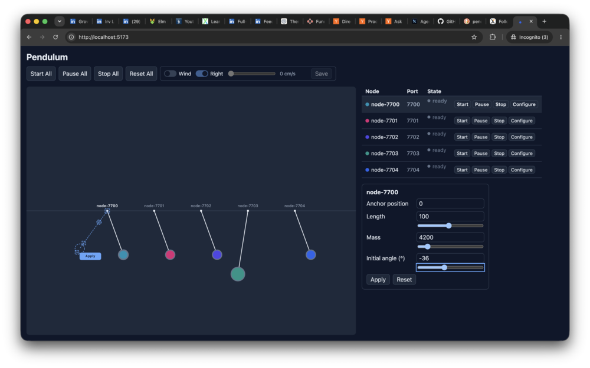
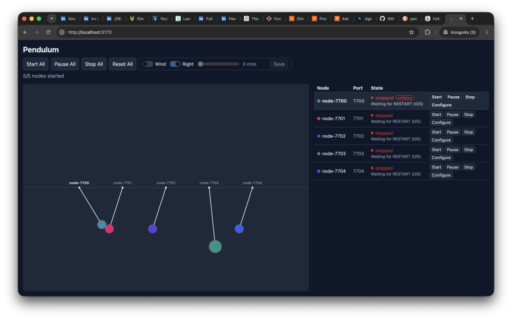

# Vention Pendulum

A distributed pendulum simulation. Each pendulum runs as its own Node.js server, and a React web UI shows and controls them.

(An earlier design that routes STOP/RESTART through an elected leader is kept on the `leader-election` branch; see [Technical decisions and trade-offs](#technical-decisions-and-trade-offs) for how the two compare.)





## Prerequisites

- Node.js (v18+) and npm
- A single host: nodes bind to `127.0.0.1` only, and node discovery is local-machine-only (see [Known limitations](#known-limitations))

## Installing and running

### Install dependencies

```sh
cd nodes && npm install
cd ../web && npm install
```

### Run a pendulum node

```sh
cd nodes
npm start [-- --x <number> --length <number> --mass <number> --angle <number>]
```

Each node binds to the first free port starting at `7700`.

### Run the web UI

```sh
cd web
npm run dev
```

It opens on Vite's default port (`5173`) and discovers running nodes by scanning `127.0.0.1:7700` upward.

### Run the full demo with one script

```sh
./scripts/start-demo.sh
```

Builds the nodes once, then starts five node processes and the web UI as background jobs of the script, printing the UI URL when they're up. `Ctrl+C` stops all of them. This is a convenience script for local development and manual testing, not a process manager: it's plain bash (`&`/`wait`/`trap`), with no `concurrently`, Docker, or Windows-specific equivalent.

### Example: driving a node with curl

Start a node with a long pendulum at 45°:

```sh
cd nodes
npm start -- --angle=45 --length=200
```

In another terminal, inspect it, start it, and change its configuration:

```sh
curl http://localhost:7700/status          # identity, pendulum state, config, lifecycle
curl -X POST http://localhost:7700/start   # start swinging
curl -X POST http://localhost:7700/pause   # freeze in place; /start resumes
curl -X POST http://localhost:7700/stop    # halt; /start swings again from the initial angle
curl http://localhost:7700/config
curl -X PUT http://localhost:7700/config \
  -H 'Content-Type: application/json' \
  -d '{"angle": 30, "mass": 35}'            # resets the pendulum to the new initial angle
curl -X PUT http://localhost:7700/wind \
  -H 'Content-Type: application/json' \
  -d '{"enabled": true, "direction": "right", "speed": 3000, "airDensity": 0.001225, "dragCoefficient": 0.47}'
curl -X DELETE http://localhost:7700/wind  # disables wind again
```

The node's terminal redraws a one-line status summary (angle, bob position and lifecycle) twice a second, and prints protocol events (peers joining, collisions, STOP and RESTART) on separate lines above it.

### Example: five pendulums that collide

Start five nodes, each in its own terminal and in this order, so they take ports `7700` to `7704` and hang 100 units apart:

```sh
cd nodes
npm start                                 # node-7700
npm start -- --length=80 --angle=50       # node-7701
npm start -- --angle=30                   # node-7702
npm start                                 # node-7703
npm start                                 # node-7704
```

The nodes find each other within a second or so. Start them all, either with **Start** in the web UI or with curl:

```sh
for port in 7700 7701 7702 7703 7704; do curl -s -X POST localhost:$port/start & done; wait
```

`node-7701` swings faster than its neighbours, and about 9 seconds later its bob hits `node-7702`'s. Whichever of the two detects it (usually both, on the same tick) broadcasts STOP; every node stops, holds still for half a second, broadcasts RESTART, waits for RESTART from all the others, and 5 seconds later they all swing again from their initial angles. Because the setup is the same, the cycle repeats.

To watch a node's view of the cluster (stop epoch, peers, RESTART barrier):

```sh
curl http://localhost:7700/protocol-status
```

Killing a node does not stop the others: its peers suspect it after 2 seconds of silence and drop it after 10. Since every node can stop the cluster, there is nothing to take over.

## Architecture

The system has two kinds of process: **pendulum nodes** (Node.js/TypeScript/Express) and a **web UI** (React/Vite), each independently started as described above.

Each node owns exactly one pendulum's simulation and runs it at a fixed 60 Hz timestep, regardless of whether anything is watching. On startup a node claims the first free port from `7700` upward, derives its ID from that port (`node-7701`), and probes the lower ports to find existing peers. From that point on, nodes talk directly to each other over HTTP: they exchange heartbeats and positions, and a node that detects a collision broadcasts STOP to all of them directly. The design is fully leaderless: there is no election, lease, or coordinator service, and every node runs the same code in the same role.

The web UI never simulates or coordinates anything itself. It discovers nodes by polling `127.0.0.1:7700` and upward over HTTP, then polls each discovered node's `/status` for state to render as SVG, and issues `/config`, `/start`, `/pause`, `/stop`, and `/wind` calls (individually or across all nodes) in response to user actions. It is a client/controller, and every configuration and lifecycle change is applied by calling the same REST endpoints a `curl` script would use.

Full contracts live in [`docs/interfaces.md`](docs/interfaces.md) (CLI, HTTP API, UI/discovery behavior) and [`docs/coordination.md`](docs/coordination.md) (membership, stop epochs, collision detection, STOP/RESTART). Motion and collision math are in [`docs/physics.md`](docs/physics.md); wind is in [`docs/bonus-wind.md`](docs/bonus-wind.md).

## Physics model

Each pendulum is a simplified idealization, not a full rigid-body simulation:

- The rod is rigid and massless, and does not participate in collision detection — only the spherical bob does. Hinge points can't collide either.
- There's no friction or damping, so an undisturbed pendulum with wind off swings forever at constant amplitude (wind is the exception: its relative-velocity drag also damps the bob's own motion, and since wind is assumed constant rather than gusting, that damping has a fixed target to settle toward, so oscillations decay to a standstill at a wind-dependent lean angle rather than continuing indefinitely).
- Motion uses the full nonlinear pendulum equation (`α = -(g/L)sin(θ)`), not a small-angle approximation.
- Bobs are spherical and share one unit density, so radius is derived from mass (`r = ∛(3m/4π)`) rather than set independently.
- Collisions are detected, not resolved: overlapping bobs trigger the STOP/RESTART protocol instead of bouncing or exchanging momentum.

### Wind (bonus)

Each node can carry a constant, horizontal wind (left or right) that adds a drag term to the pendulum equation, computed from wind and bob velocity's *relative* speed rather than a fixed force — so a bob swinging with the wind feels less drag than one swinging against it. Wind is off by default, is set per node with `PUT /wind` and cleared with `DELETE /wind`, and is not part of a node's ordinary `/status` response: the web UI is the sole owner of the displayed on/off state and sends the same command to every node. The existing collision-triggered restart is also this project's only "reset" operation, so it doubles as the wind reset: a node clears its own wind the moment it re-arms for RESTART (`Simulation.beginRestart()`), and the UI clears its displayed toggle the moment it sees any node enter `restarting`. Full contract, formulas, and validation limits are in [`docs/bonus-wind.md`](docs/bonus-wind.md).

Full details, including units and the fixed-timestep integrator, are in [`docs/physics.md`](docs/physics.md).

## Technical decisions and trade-offs

- **HTTP polling, not WebSockets.** Both node-to-node messaging and UI-to-node updates are plain JSON-over-HTTP requests on a fixed interval, per [`interfaces.md`](docs/interfaces.md). This keeps every interaction request/response and easy to test with `curl` or `supertest`, at the cost of update latency and steady request volume compared to a push-based transport.
- **Single host only.** Nodes bind to `127.0.0.1` and discovery is a local port scan; there is no `--peers` flag or multi-host membership. This matches the challenge's scope and avoids designing a discovery protocol the project doesn't need yet.
- **Latest-known-state collision detection.** Each node caches the most recent `POSITION` it has seen from each peer (by sequence number) and checks its own bob against that cache; there's no synchronized clock or interpolation between updates. This is simple and robust to message loss or reordering, at the cost of checking against slightly stale peer positions.
- **Peer geometry from `JOIN_RESPONSE`, not from every `POSITION`.** A node learns peer length/anchor once, at join time, and assumes it stays fixed for the session, rather than re-sending full config on every position broadcast. This keeps position messages small; a peer that changes its length or hinge mid-run will be checked against its old geometry until it rejoins.
- **Leaderless STOP/RESTART, numbered by epoch.** A node that detects a collision broadcasts STOP with the next epoch number (one past the newest it has seen; heartbeats keep everyone's epoch in step), and every stopped node pauses for 500 ms (so the collision stays visible), broadcasts RESTART and waits for RESTART from every live node. Both bobs in a collision usually detect it on the same tick, pick the same epoch, and their STOPs merge into one stop. Compared with the leader-based design on `leader-election`:
  - *Gained:* a literal match with the spec's wording; STOP takes one hop instead of two; no window after a node dies (or at startup) in which collisions are ignored while an election runs; about 250 fewer lines of production code, three fewer message types (`ELECTION_REQUEST`, `ELECTION_RESPONSE`, `COLLISION_DETECTED`), and no election timers to tune.
  - *Lost:* a single point that orders decisions. On `leader-election`, a leader that can't reach a majority refuses to stop anyone, so a node cut off from the rest can't act on a stale view. On a single host a network split can't happen, so this protects against nothing here, but it would matter on multiple hosts.
  - *Unchanged:* message volume. POSITION (60 per second to every peer) and heartbeats are all-to-all in both designs, and RESTART was already all-to-all, so the extra STOP from a second detector is negligible at any cluster size.
- **The UI, not the nodes, owns whether wind is "on."** A node only ever knows its own wind configuration and never reports it in `/status`; the web UI tracks the on/off toggle locally and re-sends `PUT`/`DELETE /wind` to every node it knows about. This matches [`docs/bonus-wind.md`](docs/bonus-wind.md) and avoids a second source of truth, at the cost of the UI's toggle being unable to detect a node that silently reverted (e.g. a mid-flight failed request only surfaces via the one-shot error message, not an ongoing indicator).
- **Wind resets exactly where the pendulum already resets.** Rather than invent a second "reset" concept, wind is cleared at the one point the project already resets simulation state after a collision (`Simulation.beginRestart()`), and the UI clears its toggle when it observes any node enter `restarting`. A manual per-node `/stop` + `/start` does not clear wind, since that isn't the collision-triggered reset the bonus doc describes.

## Known limitations

- Single-host operation only: all nodes and the UI must run on the same machine (`127.0.0.1`).
- Collision detection is an approximation based on each peer's latest known position, not a synchronized simulation step.
- The design supports any number of nodes (`N >= 2`) and isn't hard-coded to five, but the standard demo and multi-node tests use five.
- No persistence: node configuration and simulation state live in memory and reset when a node restarts.
- Any node can stop the whole cluster, including one whose view of it is stale; nothing checks that the stopping node can reach a majority. This is safe on one host but would need revisiting for multi-host operation (the leader-based design on `leader-election` does check).
- A node that joined within the last heartbeat interval (500 ms) may not yet know the cluster's newest epoch; if it is started and detects a collision in that window, its STOP carries a stale epoch that the others ignore, so it stops alone and resumes after the 10-second RESTART barrier timeout. A node is normally started well after it joins, so this needs a node to restart into a cluster that has already stopped at least once and be started within half a second.
- Wind is constant while enabled (no gusts/turbulence), horizontal-only (left/right), and applies only to the bob (not the rod), per [`docs/bonus-wind.md`](docs/bonus-wind.md)'s scope.
- The UI's wind toggle is a best-effort mirror of node state: it reflects the last command it successfully sent (or a reset it observed), not a live readback, since nodes don't report wind in `/status`.

## Running the tests

Install dependencies in both `nodes` and `web` first, then from the repository root:

```sh
npm test                # all tests: node servers, then web UI
npm run test:nodes      # node server tests only
npm run test:web        # web UI tests only
npm run test:coverage   # all tests with coverage reports and minimum thresholds
```

For watch mode during development, run `npm run test:watch` inside `nodes` or `web`.

The node tests include multi-process coordination tests that start real nodes on ports `7700` and up, so stop any running nodes first. They take about 30 seconds, most of it waiting out the 10-second peer timeout.
